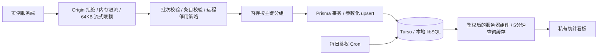

# 匿名统计收集服务：服务端设计与实施边界

依据：错题本仓库 `doc/TELEMETRY_DESIGN.md` 定稿 v4（2026-11-01），重点落实 §7、§10、§12 收集服务 A/B/C。目标目录为独立仓库 `wrong-notebook-telemetry`。该设计针对本地可交付的服务端；外部账户、Turso 集成、Vercel 项目、域名、生产密钥和公开发布由后续部署阶段配置。

## 1. 架构

- Next.js 16 App Router，Node.js 运行时。ingest 最长 10 秒；数据库事务最长 8 秒。
- Prisma 5.22 + `@prisma/adapter-libsql` 5.22 + 兼容的 `@libsql/client` 0.8。与主应用选型一致，不通过跳过 peer 校验强行混装。
- 数据库连接惰性初始化：生产构建不依赖凭据、不执行迁移。Vercel 环境拒绝本地文件数据库。
- `/privacy` 和服务首页公开；`/dashboard/**` 及其所有写接口鉴权。公开页面不查询统计表。

## 2. 协议与兼容决策

`POST /api/v1/ingest` 仅接受 `Content-Type: application/json`，不接受压缩。请求体实际 UTF-8 字节上限 65,536，流式读取时检查，不相信调用方的 Content-Length。存在 Origin 头即返回 403，不设置 CORS。

批次严格限定 `{schema, app, version, items}`：app 固定 `wrong-notebook`，version 为 1–48 位版本 token，items 为 1–100 条。未知协议返回 410；整体结构错误返回 400。合法批次逐条校验，返回 `{accepted, rejected, minIntervalSec}`；非法条目不重试，因此全批条目非法时也返回 200。

| 字段 | 规则 |
| --- | --- |
| 事件名 | `^[a-z][a-z0-9_]{1,47}$`，不维护事件白名单 |
| payload | 最多 8 键；只允许布尔或 `^[A-Za-z0-9_.<>+-]{1,32}$` 短 token |
| 维度键 | `^[a-z][A-Za-z0-9_]{1,47}$`，拒绝原型保留键 |
| day | 有效 UTC 日期，今天前 7 天至后 1 天，含边界 |
| 错误 kind | `client / boundary / server` |
| 错误 scope | 1–64 位 ASCII token，允许命名空间的 `:` 和全局错误的 `[]` |
| 错误 name | 1–64 位错误名称 token，允许大写，例如 TypeError |
| fingerprint | 16 位小写十六进制 |

原设计中三处表述与样例冲突，实施时作如下明确解释：

1. payload 键规则兼容 `aiConfigured` 驼峰；事件名仍为小写。
2. scope 兼容 `api:ai` 和 `[GlobalError]`；不接受空格、路径、URL 或任意文本。
3. 按 IP 限流必然要临时读取来源地址，因此应用只读取可信代理地址，用进程随机 HMAC 密钥生成限流键，不保存 IP 或限流键、不打印请求头。隐私页如实披露；不承诺“完全不读取 IP”。

`tests/fixtures/contract-v1.json` 包含设计中的全部 14 个事件与三类错误。后续实例仓库应复制同一份契约模块和向量；跨仓库联调前不能声称已完成实例端联调。短 token 限制减少任意内容进入的机会，不能证明调用方提供的每个 token 都符合语义或来自真实实例。

## 3. 聚合与一致性

| 表 | 主键/含义 |
| --- | --- |
| DailyEvent | day + version + name + 维度按键排序的 JSON，累加 count |
| DailyError | day + version + 部署形态 + fingerprint，累加 count |
| ErrorFingerprint | 指纹、分类、首次/最近出现日期和版本、累计数、人工状态与备注、首次脱敏摘要/栈首帧/路径/部署形态/digest |
| ServiceSetting | 最小间隔、暂停截止时间、停用应用版本、停用协议版本 |
| DailyUsage | 成功处理批次、接受/拒收条目、每日维护时的分组行数与数据库分配字节 |

不设原始事件表，不保存精确事件时间、来源、用户或实例 ID、完整 stack、UA 或逐条错误原文。首次错误摘要按指纹保存一份，经过实例脱敏与截断，仍可能残留业务文本。ServiceSetting 的更新时间用于配置管理，不表示上报时间。维护者 Cookie 仅用于看板登录，不参与统计。

批次先在内存分组，再在一个数据库写事务中累加事件、错误、指纹和用量。每张表使用一条参数化多行 upsert，混合批次最多四条写入语句，避免最多一百个分组逐个远程往返；最大指纹语句为九百个参数。错误指纹日期以 SQL MIN/MAX 原子更新，乱序重试不能倒退。相同日期不能判断真实先后，首次到达的版本信息保留；人工状态与备注不被上报覆盖。

没有实例或批次 ID，无法实现重试去重和身份级删除；收到成功响应前断线可能导致重复计数。日活使用 instance_alive 近似值，多日合计为实例天数，不能作为去重用户数、精确安装量或计费依据。

## 4. 防护与配置

- 应用限流：ingest 每来源每分钟 10 次；登录每来源 15 分钟最多 5 次失败。计数只在函数进程内，最多 10,000 个键；容量满时拒绝新来源，过期后回收。
- Vercel 只信任平台清洗的 `x-vercel-forwarded-for`。本地默认所有调用共用 unknown 桶。自建反向代理启用 `TRUST_PROXY_HEADERS=true` 前必须清洗并重写转发头，且禁止绕过代理直连应用。
- 登录使用 bcrypt，七天 HMAC 签名 Cookie。Cookie HttpOnly、SameSite=Strict；生产为 Secure + `__Host-` 前缀；HTTP 开发使用独立名称。密码或会话密钥轮换会使旧 Cookie 失效。
- 登录、退出、设置与错误标记写接口均要求同源 Origin，写接口还要求有效会话。凭据不完整时关闭访问。页面布局与页面查询分别鉴权，覆盖 App Router 并行渲染。
- 停用列表由环境变量与数据库取并集，命中返回 410。暂停返回 200、accepted=0、rejected=批量条数并下发 retryAfterSec；按既定实例协议，这会丢弃该批次，暂停适合应急止损，不能作为无损背压。
- `INGEST_PAUSED=true/false` 显式覆盖数据库暂停；留空沿用数据库。设置缓存最多 5 分钟，本进程修改立即失效。
- 日志仅打印固定错误码，应用错误响应不回传异常详情。平台访问/安全日志是独立边界，见隐私说明。

## 5. 看板

服务器组件先鉴权再查询聚合表；结果缓存五分钟，HTTP 页面仍为私有动态内容。范围支持 7、30、90、400 天，日期按 UTC。总览、按天趋势、安装数、版本/部署形态、功能事件与前 500 个维度组合、AI 成功率及耗时、按状态筛选的前 100 个错误指纹及趋势均由数据库聚合得到；错误详情页另展示首次样本与按版本/部署形态分布。

## 6. 维护、预算与迁移

每天 UTC `03:17` 触发 `/api/cron/maintain`，仅接受强 `CRON_SECRET` Bearer 鉴权。保留今天及之前 399 天，清除更早的 DailyEvent、DailyError、DailyUsage，以及 lastSeenDay 已过期的指纹。仍活跃指纹的首次日期与累计数随指纹保留。任务幂等，重复执行不清零上报用量。

维护记录表行数和 SQLite `page_count × page_size` 分配量。空闲页尚未压缩时仍计入，不能等同 Turso 控制台存储、平台函数调用量、CPU 或行读写账单。不调用需要额外管理令牌的 Turso/Vercel 账单 API。

部署时可配置月成功批次、分组行数、数据库字节预算，默认不编造额度。达到配置预算的 70% 自动将最小间隔调至至少 12 小时，90% 调至至少 24 小时；自动策略只调大，管理员可手动恢复。平台用量通知仍必须启用。

迁移文件由 Prisma schema 生成并入库。`npm run db:migrate` 使用同一 libSQL 驱动、写事务、校验和表执行不可变迁移，适用于本地文件和 Turso；重复执行不覆盖数据，历史缺失或校验和不一致时拒绝。Prisma 5 的 migrate deploy 不直接连接 libsql URL，因此不伪称它可以用于远端 Turso。迁移不自动挂在构建流程，Preview 与 Production 使用独立库。

## 7. 验收与后续部署

本地验收使用临时目录与真实 libSQL：协议向量、并发累加、失败回滚、边界和限流、暂停/停用、设置缓存、迁移完整性、400 天清理、自动降频、鉴权和同源保护。完整 CI 还构建生产产物并启动真实 HTTP 服务验证登录、上报、看板、写接口和维护结果；测试数据随临时目录销毁。

生产验收另需：Marketplace 集成、生产与预览库隔离、Firewall 规则、真实域名 HTTPS、平台配额通知、预览环境和实例队列端到端联调。本地实现和测试通过不等于这些外部步骤已完成。
